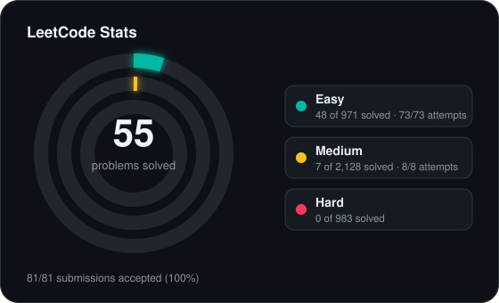
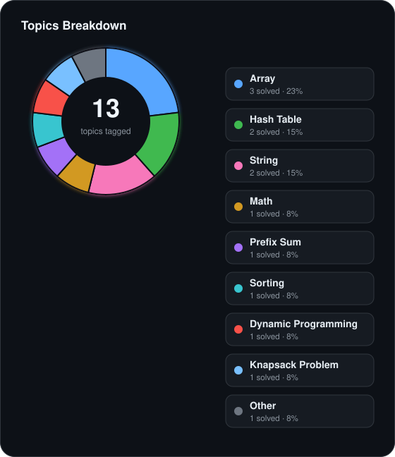

<!-- leetcode-stats:start -->
# LeetCode Solutions

Auto-synced by LeetCode to GitHub Sync.

<!-- leetcode-stats:end -->

| # | Title | Difficulty | Tags | Status |
| --- | --- | --- | --- | --- |
| 1480 | [Running Sum of 1d Array](https://leetcode.com/problems/running-sum-of-1d-array/) | Easy | Array, Prefix Sum | ✅ Accepted |<!-- id:running-sum-of-1d-array -->
| 3280 | [Convert Date to Binary](https://leetcode.com/problems/convert-date-to-binary/) | Easy | Math, String | ✅ Accepted |<!-- id:convert-date-to-binary -->
| 242 | [Valid Anagram](https://leetcode.com/problems/valid-anagram/) | Easy | Hash Table, String, Sorting | ✅ Accepted |<!-- id:valid-anagram -->
| 1 | [Two Sum](https://leetcode.com/problems/two-sum/) | Easy | Array, Hash Table | ✅ Accepted |<!-- id:two-sum -->
| 518 | [Coin Change II](https://leetcode.com/problems/coin-change-ii/) | Medium | Array, Dynamic Programming, Knapsack Problem, Complete Knapsack | ✅ Accepted |<!-- id:coin-change-ii -->
| 3545 | [Minimum Deletions for At Most K Distinct Characters](https://leetcode.com/problems/minimum-deletions-for-at-most-k-distinct-characters/) | Easy | Hash Table, String, Greedy, Sorting, Counting | ✅ Accepted |<!-- id:minimum-deletions-for-at-most-k-distinct-characters -->
| 217 | [Contains Duplicate](https://leetcode.com/problems/contains-duplicate/) | Easy | Array, Hash Table, Sorting | ✅ Accepted |<!-- id:contains-duplicate -->
| 1929 | [Concatenation of Array](https://leetcode.com/problems/concatenation-of-array/) | Easy | Array, Simulation | ✅ Accepted |<!-- id:concatenation-of-array -->
| 1672 | [Richest Customer Wealth](https://leetcode.com/problems/richest-customer-wealth/) | Easy | Array, Matrix | ✅ Accepted |<!-- id:richest-customer-wealth -->
| 20 | [Valid Parentheses](https://leetcode.com/problems/valid-parentheses/) | Easy | String, Stack, Bracket Sequences | ✅ Accepted |<!-- id:valid-parentheses -->
| 14 | [Longest Common Prefix](https://leetcode.com/problems/longest-common-prefix/) | Easy | Array, String, Trie | ✅ Accepted |<!-- id:longest-common-prefix -->
| 409 | [Longest Palindrome](https://leetcode.com/problems/longest-palindrome/) | Easy | Hash Table, String, Greedy | ✅ Accepted |<!-- id:longest-palindrome -->
| 383 | [Ransom Note](https://leetcode.com/problems/ransom-note/) | Easy | Hash Table, String, Counting | ✅ Accepted |<!-- id:ransom-note -->
| 344 | [Reverse String](https://leetcode.com/problems/reverse-string/) | Easy | Two Pointers, String | ✅ Accepted |<!-- id:reverse-string -->
| 438 | [Find All Anagrams in a String](https://leetcode.com/problems/find-all-anagrams-in-a-string/) | Medium | Hash Table, String, Sliding Window | ✅ Accepted |<!-- id:find-all-anagrams-in-a-string -->
| 141 | [Linked List Cycle](https://leetcode.com/problems/linked-list-cycle/) | Easy | Hash Table, Linked List, Two Pointers, Floyd's Cycle Finding Algorithm | ✅ Accepted |<!-- id:linked-list-cycle -->
| 219 | [Contains Duplicate II](https://leetcode.com/problems/contains-duplicate-ii/) | Easy | Array, Hash Table, Sliding Window | ✅ Accepted |<!-- id:contains-duplicate-ii -->
| 977 | [Squares of a Sorted Array](https://leetcode.com/problems/squares-of-a-sorted-array/) | Easy | Array, Two Pointers, Sorting | ✅ Accepted |<!-- id:squares-of-a-sorted-array -->
| 88 | [Merge Sorted Array](https://leetcode.com/problems/merge-sorted-array/) | Easy | Array, Two Pointers, Sorting | ✅ Accepted |<!-- id:merge-sorted-array -->
| 704 | [Binary Search](https://leetcode.com/problems/binary-search/) | Easy | Array, Binary Search | ✅ Accepted |<!-- id:binary-search -->
| 35 | [Search Insert Position](https://leetcode.com/problems/search-insert-position/) | Easy | Array, Binary Search | ✅ Accepted |<!-- id:search-insert-position -->
| 349 | [Intersection of Two Arrays](https://leetcode.com/problems/intersection-of-two-arrays/) | Easy | Array, Hash Table, Two Pointers, Binary Search, Sorting | ✅ Accepted |<!-- id:intersection-of-two-arrays -->

